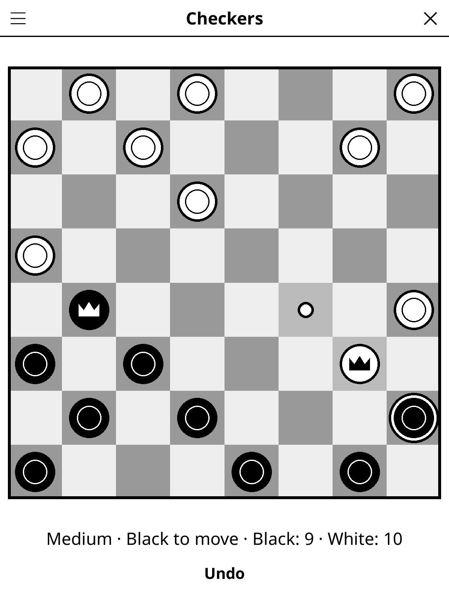

# checkers.koplugin

Checkers (English draughts, « Dames ») for
[KOReader](https://github.com/koreader/koreader): play against the AI or a
friend on the same device.

## Screenshot

## Rules

Each player has 12 pieces on the dark squares; Black plays first.

- A piece moves one square diagonally **forward** onto an empty dark square.
- It captures by **jumping** over an adjacent opponent piece onto the empty
  square just beyond it. Capturing is **compulsory**, but when several
  captures are possible you choose which one.
- After a jump, if the same piece can jump again it must keep jumping in the
  same turn (**multi-jump**).
- A piece reaching the far row is **crowned king** and may then move and
  capture one square diagonally backwards too. A piece crowned during a
  capture ends its turn there.

You win when your opponent has no pieces left or cannot move. After 40 moves
in a row without a capture (20 each), the game is drawn.

## Features

- **1 player vs AI** (easy / medium / hard / expert) or **2 players** on one
  device
- **Play as Black or White** against the AI — your pieces are always at the
  bottom
- **Move help** — the selected piece is ringed and the squares it can reach
  are dotted; only legal moves are offered, so a forced capture is enforced
- **Last move shown** — the squares the last piece went through are shaded,
  multi-jumps included
- **Undo** — against the AI, takes back the AI's reply and your move; a
  multi-jump is undone as a whole
- **Auto-save** — the game, with its undo history, is restored on next launch

## The AI

Iterative-deepening negamax with alpha-beta pruning on a compact board, with
a transposition table and killer/history move ordering. The evaluation follows
Arthur Samuel's checkers features (material, advancement, centre control,
back-row bridge). Each level searches up to a maximum depth (1, 4, 6, 9) within
a thinking-time budget (0.5 s, 1 s, 2 s, 2.3 s of CPU time on a Kobo-class
reader), whichever comes first. Easy and Medium add a random bonus to each
move's score before choosing, so they make human-sized mistakes and do not
play the same game twice; Hard and Expert always play their best move.

## Installation

1. Download `checkers.koplugin.zip` from the [latest release](../../releases/latest).
2. Extract into the `plugins/` folder of your KOReader data directory.
3. Restart KOReader.
4. Open the menu → **Tools** → **Games** → **Board games** → **Checkers**.

## Controls

| Action | How |
|--------|-----|
| Move a piece | Tap it, then tap a dotted square |
| Continue a multi-jump | Tap the next dotted square (the piece stays selected) |
| Take back a move | Tap **Undo** |
| New game, difficulty, players, colour, rules | Title-bar menu |

## Credits

Originally written by [kbarni](https://github.com/kbarni/checkers.koplugin);
this repository is a fork. The rules engine is based on the
[checkers](https://github.com/ImparaAI/checkers) Python library (MIT), and the
evaluation on [almostimplemented/checkers](https://github.com/almostimplemented/checkers)
(Apache 2.0).

## License

GPL-3.0 — see [LICENSE](LICENSE).
